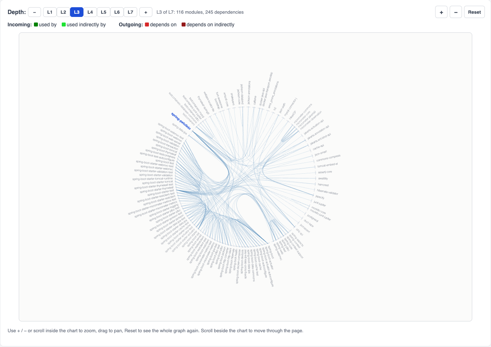
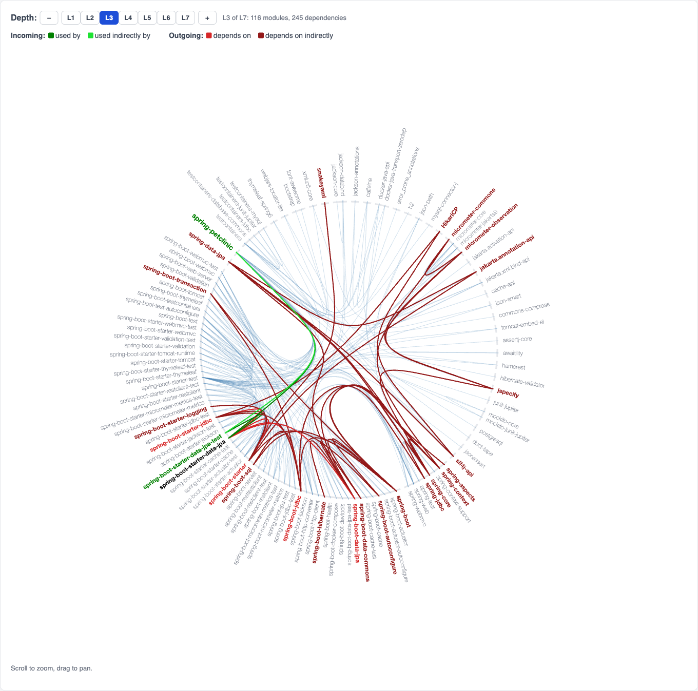
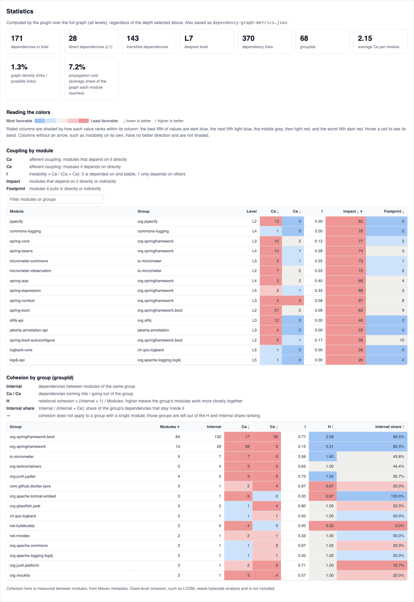
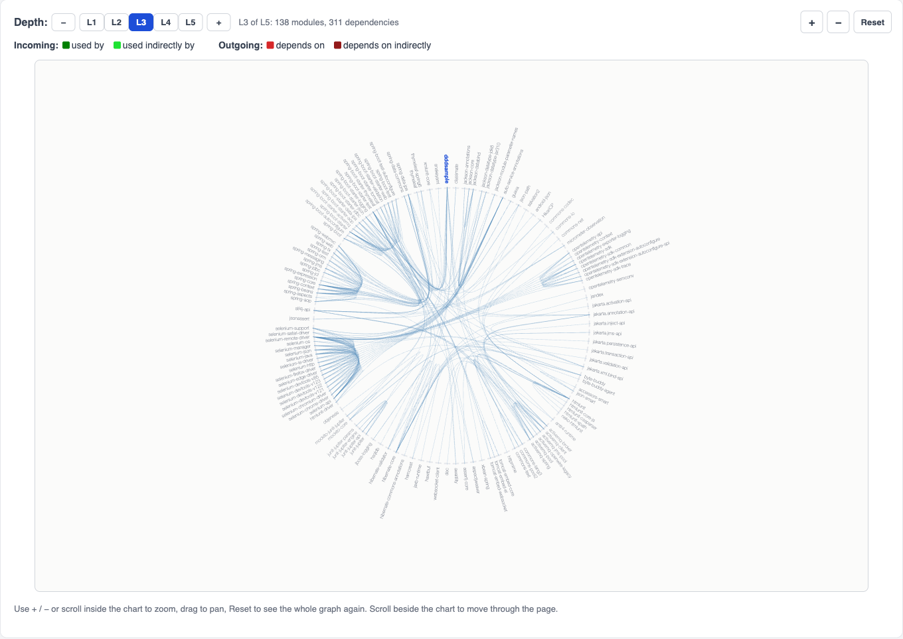
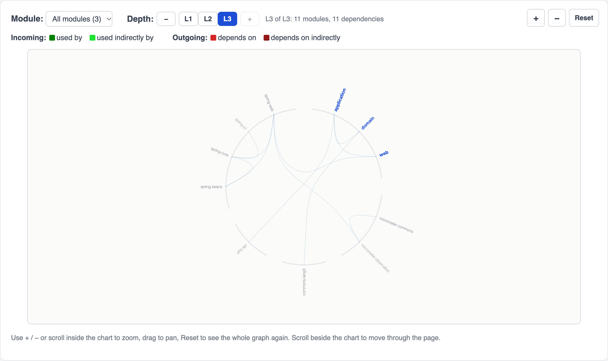
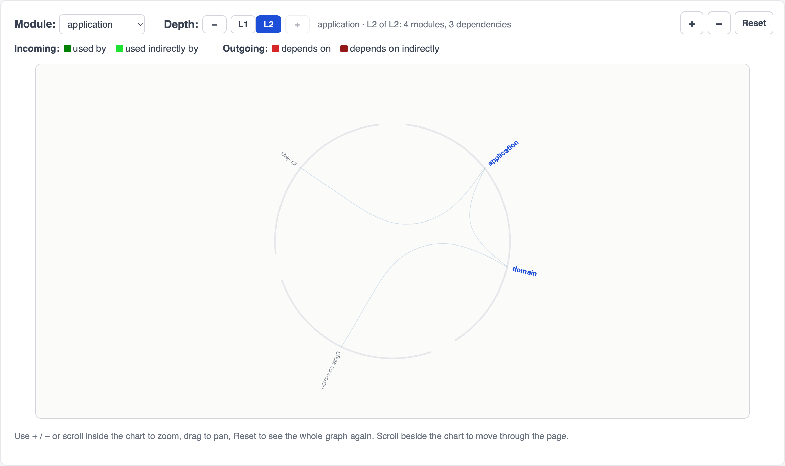

# Dependency Graph Plugin

A Maven plugin that generates a dependency report for a Maven project: an interactive D3 dependency graph plus coupling and cohesion statistics.

## Background

Dependency analysis and resolving version conflicts in Maven builds made me look deeper into how Maven dependencies fit together. Java 9 modules then required a deep analysis to break down the jigsaw puzzle of dependencies inside the JDK. Kirk Knoernschild's *Java Application Architecture*, which explains modularity patterns, maturity models and OSGi, pushed me to build the [chart of JDK module dependencies](https://wildcraft.github.io/page3/). Since then, a Maven plugin that draws the same kind of chart for any Maven project has been on my backlog; it is now getting solved with AI assistance.

## What it does

This plugin:
- collects the project's dependencies, including transitive and test scope, for a single-module project or every module of a multi-module build
- reads each resolved artifact's POM so that every declared dependency between modules becomes an edge, not only the single path Maven used to resolve it
- computes coupling and cohesion metrics for every module and groupId
- generates an HTML report titled **Dependency Graph of &lt;project name&gt;** containing:
  - a "How to read this graph" guide
  - a hierarchical edge-bundling graph, following the [JDK module dependencies chart](https://wildcraft.github.io/page3/), with a depth control
  - a statistics section with summary figures, a coupling table per module and a cohesion table per groupId

### Selected D3 rendering pattern

The plugin uses [hierarchical edge bundling](https://bl.ocks.org/mbostock/7607999) because it scales well to large Java dependency sets such as Spring and Hibernate. Every module, including the project itself (shown in blue), sits on the ring, grouped by groupId, and each dependency is drawn as a bundled edge.

Hover a module to see how it connects to the rest of the graph:

| Direction | Color | Meaning |
| --- | --- | --- |
| Incoming | Green | Used by: direct dependents |
| Incoming | Light green | Used indirectly by: transitive dependents |
| Outgoing | Red | Depends on: direct dependencies |
| Outgoing | Brown | Depends on indirectly: transitive dependencies |

### Depth control (L1, L2, L3, ...)

The page has a **Depth** control above the chart. **L1** shows only the project's direct dependencies, **L2** adds their dependencies, **L3** adds the next level, and so on, up to the deepest level in the project. Use the level buttons or **−** / **+** to change it; the graph redraws in place without re-running Maven. The current level is kept in the URL (for example `index.html#L2`), so a link opens at the same depth. Each module's tooltip shows its level.

The chart sizes itself from the number of modules and is drawn in a centered, bordered rectangle that fills the card width and most of the window height, so the whole graph is visible. The margin on each side of it lets you scroll the page with the pointer beside the chart; scrolling inside the border zooms it instead. Use the **+** / **−** buttons in the top-right corner of the graph card (or scroll inside the chart) to zoom, drag to pan, and **Reset** to return to the full view. The tooltip on each label shows the full `groupId-artifactId`, its level and its incoming/outgoing counts at the selected depth.

### Statistics: coupling and cohesion

The statistics are computed by the plugin over the full graph (all levels), shown below the graph and also written to `dependency-graph-metrics.json` so they can be used in CI or other tools.

**Summary:** total, direct (L1) and transitive dependencies, deepest level, dependency links, number of groupIds, average Ce, graph density (links / possible links) and propagation cost (the average share of the graph each module reaches directly or indirectly).

**Coupling by module** ([Robert C. Martin's package metrics](https://en.wikipedia.org/wiki/Software_package_metrics)):

| Metric | Better | Meaning |
| --- | --- | --- |
| Ca (afferent coupling) | lower | Modules that depend on it directly |
| Ce (efferent coupling) | lower | Modules it depends on directly |
| I (instability) | neither | Ce / (Ca + Ce): 0 means depended on and stable, 1 means it only depends on others |
| Impact | lower | Modules that depend on it directly or indirectly, i.e. what may be affected if it changes |
| Footprint | lower | Modules it pulls in directly or indirectly |

**Cohesion by group (groupId):**

| Metric | Better | Meaning |
| --- | --- | --- |
| Internal | neither | Dependencies between modules of the same group |
| Ca / Ce | lower | Dependencies coming into / going out of the group |
| I (instability) | neither | Ce / (Ca + Ce) for the group |
| H (relational cohesion) | higher | (Internal + 1) / Modules: higher means the group's modules work more closely together |
| Internal share | higher | Internal / (Internal + Ce): share of the group's outgoing dependencies that stay inside it |

H and Internal share are shown as "—" for groups with a single module, since there are no internal dependencies to measure, and those groups are left out of the cohesion ranking.

**Favorable and unfavorable values are color-coded.** Each column with a "better" direction (marked ↓ lower is better or ↑ higher is better in the table header) is shaded by how each value ranks within its column, on a five-step scale with a legend:

| Shade | Band |
| --- | --- |
| Dark blue | Most favorable fifth |
| Light blue | Favorable |
| Grey | Middle |
| Light red | Unfavorable |
| Dark red | Least favorable fifth |

Ranking uses mid-rank percentiles, so tied values (for example the many modules with Ce 0) share a band. Hovering a cell shows its band in words. Blue and red are used instead of green and red so the scale stays readable for colorblind viewers. Columns with no better direction, such as instability on its own, are not shaded.

Both tables can be sorted by clicking a column, the module table can be filtered, and hovering a row highlights that module in the graph. These are module-level (package-level) metrics, not the [Chidamber & Kemerer (CK)](https://doi.org/10.1109/32.295895) suite. CK metrics such as coupling between objects (CBO) and lack of cohesion in methods (LCOM) are measured per class and need bytecode analysis, so they are not included. The report lists its sources in a References section at the bottom of the page.

The generated output is placed under:

```text
target/dependency-graph/
```

with files:
- `index.html`: the report
- `dependency-graph-data.js`: graph data, project details and metrics used by the report
- `dependency-graph-metrics.json`: the coupling and cohesion metrics on their own

## Multi-module projects

Run the goal once from the root of a multi-module build:

```bash
mvn io.github.wildcraft:dependency-graph-plugin:1.0.0:generate
```

The plugin runs once for the whole build (it is an aggregator) and writes a single report to the root's `target/dependency-graph/`. The modules do not need to be built or installed first: the plugin reads the dependency structure from the POMs, so a module that depends on a sibling module works straight from a fresh checkout. Parent and aggregator POMs (packaging `pom`) are left out of the graph.

In the report:
- **All modules** is the default view. It shows every module of the project in blue, the dependencies between modules, and everything they pull in. Levels count from the nearest module, so L1 holds every module's direct dependencies.
- The **Module** selector redraws the chart for a single module: that module, the sibling modules it uses, and their dependencies, with levels counted from the chosen module. The selection is kept in the URL (for example `index.html#L2&module=demo.shop-web`).
- The statistics cover the whole project. Each module of the project gets its own row in the coupling table, so its Ca and Ce include dependencies between modules. The summary also shows the number of modules, and "direct external dependencies" counts each third-party dependency once, however many modules declare it.

This was tested on a three-module build (`web` → `application` → `domain`) run from a fresh checkout with nothing installed. Its report is included as the [multi-module sample](#multi-module-shop) below.

## Plugin coordinates

```text
io.github.wildcraft:dependency-graph-plugin
```

## Build and run

Install the plugin from this repository, then run it from the project you want to analyze:

```bash
mvn clean install
mvn io.github.wildcraft:dependency-graph-plugin:1.0.0:generate -Ddependency.graph.depth=3 -Ddependency.graph.includeTransitive=true
```

Requires Java 17+.

To use the short form `mvn dependency-graph:generate`, add the group to `~/.m2/settings.xml`:

```xml
<settings>
  <pluginGroups>
    <pluginGroup>io.github.wildcraft</pluginGroup>
  </pluginGroups>
</settings>
```

| Property | Default | Description |
| --- | --- | --- |
| `dependency.graph.depth` | `3` | The level (L1, L2, ...) the page opens at. All levels are always written, so you can switch depth in the page. |
| `dependency.graph.includeTransitive` | `true` | Include resolved transitive dependencies. |
| `dependency.graph.outputDirectory` | `target/dependency-graph` | Where the report, data and metrics files are written. |

Then open:

```text
target/dependency-graph/index.html
```

## Example output shape

```js
window.dependencyGraphData = [
  {"imports":["com.google.errorprone-error_prone_annotations","org.jspecify-jspecify"],"group":"com.github.ben-manes.caffeine","label":"caffeine","level":1,"name":"com.github.ben-manes.caffeine-caffeine"},
  {"imports":["com.github.ben-manes.caffeine-caffeine", ...],"group":"org.springframework.samples","label":"spring-petclinic","level":0,"name":"org.springframework.samples-spring-petclinic","project":true},
  ...
];
window.dependencyGraphDepth = 3;
window.dependencyGraphProject = {"name":"petclinic","groupId":"org.springframework.samples","artifactId":"spring-petclinic","version":"4.0.0-SNAPSHOT","generated":"2026-11-07 22:31:04"};
window.dependencyGraphMetrics = { "summary": {...}, "modules": [...], "groups": [...] };
```

`dependency-graph-metrics.json`:

```json
{
  "summary":{"modules":171,"directDependencies":28,"transitiveDependencies":143,"dependencyEdges":370,"maxLevel":7,"averageCe":2.1512,"density":0.0126,"propagationCost":0.0721,"groups":68},
  "modules":[
    {"name":"org.springframework.boot-spring-boot","group":"org.springframework.boot","level":2,"project":false,"ca":21,"ce":2,"instability":0.0870,"transitiveCa":63,"transitiveCe":9},
    ...
  ],
  "groups":[
    {"name":"org.springframework","modules":13,"internal":29,"ca":28,"ce":5,"instability":0.1515,"relationalCohesion":2.3077,"cohesionRatio":0.8529},
    ...
  ]
}
```

## Sample reports

The plugin was run against two well-known open source Spring Boot projects, each a single Maven module, and against a small multi-module build. The full generated reports are checked in under [`docs/samples/`](docs/samples/):

| Project | What it is | Dependencies | Levels | Links | Report |
| --- | --- | --- | --- | --- | --- |
| [Multi-module Shop](docs/samples/multi-module-shop/project/) | A three-module test build: `web` → `application` → `domain` | 8 (3 direct) | L1–L3 | 11 | [download](https://github.com/Wildcraft/depedency-graph-plugin/raw/main/docs/samples/downloads/multi-module-shop-dependency-graph.zip) · [live](https://wildcraft.github.io/depedency-graph-plugin/samples/multi-module-shop/) · [files](docs/samples/multi-module-shop/) · [metrics](docs/samples/multi-module-shop/dependency-graph-metrics.json) |
| [Spring Petclinic](https://github.com/spring-projects/spring-petclinic) | The Spring team's reference sample application | 171 (28 direct) | L1–L7 | 370 | [download](https://github.com/Wildcraft/depedency-graph-plugin/raw/main/docs/samples/downloads/spring-petclinic-dependency-graph.zip) · [live](https://wildcraft.github.io/depedency-graph-plugin/samples/spring-petclinic/) · [files](docs/samples/spring-petclinic/) · [metrics](docs/samples/spring-petclinic/dependency-graph-metrics.json) |
| [DDDSample](https://github.com/citerus/dddsample-core) | The cargo shipping and tracking application from Eric Evans' *Domain-Driven Design* | 174 (13 direct) | L1–L5 | 380 | [download](https://github.com/Wildcraft/depedency-graph-plugin/raw/main/docs/samples/downloads/dddsample-dependency-graph.zip) · [live](https://wildcraft.github.io/depedency-graph-plugin/samples/dddsample/) · [files](docs/samples/dddsample/) · [metrics](docs/samples/dddsample/dependency-graph-metrics.json) |

Each **download** link gets a `.zip` with the report exactly as the plugin generated it (`index.html`, `dependency-graph-data.js` and `dependency-graph-metrics.json`); unzip it and open `index.html` in a browser. GitHub shows `.html` files as source code, which is why the reports are zipped. The **live** links work once GitHub Pages is enabled for this repository with the `docs/` folder as its source. To view a report without Pages, clone the repository and open `docs/samples/<project>/index.html` in a browser.

For Petclinic and DDDSample, every dependency that `mvn dependency:list` resolves (including test scope) appears in the report, with none missing or extra.

To reproduce a report, install this plugin (`mvn install` in this repository), then run it from the sample project's directory:

```bash
./mvnw io.github.wildcraft:dependency-graph-plugin:1.0.0:generate
```

### Spring Petclinic

The report is titled **Dependency Graph of petclinic** (the `<name>` in the project's POM). The plugin reported all 171 dependencies that `mvn dependency:list` resolves for the project, including test scope, with none missing or extra. The 28 dependencies declared in the POM appear at L1, and reading each artifact's POM gives 370 dependency links between them. The depth control goes from L1 to L7:

| Level | Modules shown (including `spring-petclinic`) |
| --- | --- |
| L1 | 29 |
| L2 | 63 |
| L3 (default) | 116 |
| L4 | 154 |
| L5 | 168 |
| L7 | 172 |



Hovering `spring-boot-starter-data-jpa` shows its incoming dependents in green: `spring-boot-starter-data-jpa-test` directly and `spring-petclinic` indirectly. Its direct outgoing dependencies, such as `spring-boot-starter-jdbc` and `spring-boot-data-jpa`, are red, and transitive ones, such as `HikariCP` and `spring-core`, are brown:



The statistics show that `spring-boot` is the most directly used module (Ca 21) and `jspecify` has the widest impact (92 modules depend on it directly or indirectly). Both show up dark red in their columns. The `org.springframework` group is the most cohesive large group: 85% of its dependencies stay inside it, so its H and Internal share are dark blue, and its low instability (0.15) reflects that the rest of the graph depends on it. At the other end, `net.bytebuddy` has two modules that don't depend on each other, so its cohesion is dark red:



### DDDSample (cargo shipping)

The [DDD Sample application](https://github.com/citerus/dddsample-core) models cargo booking, routing and tracking. Its report is titled **Dependency Graph of DDDSample** and covers 174 dependencies over five levels, with 13 declared directly in the POM.



Its statistics tell a different story from Petclinic. `slf4j-api` is the most directly used module (Ca 18) and has the widest impact (36 modules depend on it directly or indirectly). Selenium, pulled in for browser tests, is the largest group (19 modules) and is highly unstable (I 0.94): it depends on many other groups while nothing else in the graph depends on it. `org.springframework` is again the most cohesive large group: 89% of its dependencies stay inside it.

### Multi-module Shop

A three-module build whose POMs are checked in under [`docs/samples/multi-module-shop/project/`](docs/samples/multi-module-shop/project/): `domain` uses `commons-lang3`, `application` uses `domain` and `slf4j-api`, and `web` uses `application` and `spring-web`. Running the goal once from the parent POM gives a single report titled **Dependency Graph of Shop**.

**All modules** shows the three modules in blue, the links between them, and the 8 third-party dependencies they pull in:



Picking `application` in the **Module** selector redraws the chart for that module alone: the `domain` module it uses and their dependencies, with levels counted from `application` (L1–L2). `web` and `spring-web` drop out because `application` doesn't depend on them:



To reproduce it, run the goal from `docs/samples/multi-module-shop/project/` after installing this plugin.

## Project status

The project is release-ready for GitHub and Maven Central publication, with metadata and release configuration added to the POM.

## References

**Metrics**
- Robert C. Martin, "OO Design Quality Metrics: An Analysis of Dependencies", 1994; and *Agile Software Development: Principles, Patterns, and Practices*, Prentice Hall, 2002. Afferent coupling (Ca), efferent coupling (Ce) and instability (I).
- Alan MacCormack, John Rusnak and Carliss Y. Baldwin, "Exploring the Structure of Complex Software Designs: An Empirical Study of Open Source and Proprietary Code", *Management Science* 52(7), 2006. Propagation cost.
- NDepend, [Code Metrics](https://www.ndepend.com/docs/code-metrics). Relational cohesion (H).
- Shyam R. Chidamber and Chris F. Kemerer, ["A Metrics Suite for Object Oriented Design"](https://doi.org/10.1109/32.295895), *IEEE Transactions on Software Engineering* 20(6), 1994. Class-level metrics, not computed by this plugin.

**Modularity and visualization**
- Kirk Knoernschild, *Java Application Architecture: Modularity Patterns with Examples Using OSGi*, Prentice Hall, 2012.
- Danny Holten, "Hierarchical Edge Bundles: Visualization of Adjacency Relations in Hierarchical Data", *IEEE Transactions on Visualization and Computer Graphics* 12(5), 2006.
- Mike Bostock, [Hierarchical Edge Bundling](https://bl.ocks.org/mbostock/7607999) (D3 example).
- Wildcraft, [Java 9 - JDK Module Dependencies](https://wildcraft.github.io/page3/), 2017.

**Maven plugin development**
- https://www.baeldung.com/maven-plugin
- https://maven.apache.org/plugin-developers/index.html